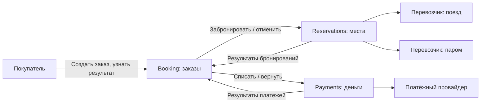

# 1. Карта контекстов

## Тема и главное правило

«Сквозной билет» продаёт маршрут из двух частей: поезд и паром. Успешный заказ означает две брони и одно списание полной суммы. Отменённый заказ означает отсутствие активных броней и отсутствие списанных денег, либо их полный возврат.

Нельзя задвоить место или платёж. Нельзя потерять принятую покупку при перезапуске процесса. Сбой возможен после первого бронирования или после списания денег.

## Почему система распределённая

Перевозчики и платёжный провайдер — независимые системы. Они могут обслуживать других клиентов и имеют собственные базы. Мы не можем включить их операции в одну SQL-транзакцию. Даже один наш сервис не превратил бы всю покупку в систему с одной базой.

Три внутренних сервиса нужны для разделения ответственности. Само их количество не делает тему распределённой: ключевая причина — независимые владельцы мест и денег.

## Сервисы

**Booking — заказы.** Принимает покупку, хранит выбранный маршрут и фиксированную цену, текущий шаг и результат. Решает, какой шаг выполнить дальше и что отменить при сбое. Отдельный сервис нужен, потому что именно он отвечает за маршрут целиком. Его данные: заказы, шаги покупки, ключи повторных запросов. Каталог маршрутов заранее заполнен; клиент не задаёт сумму оплаты.

**Reservations — бронирования.** Создаёт и отменяет брони у двух перевозчиков, хранит их номера и результаты операций. Отдельный сервис нужен для работы с местами и API перевозчиков; ему не требуется знать устройство платежей. Его данные: брони отдельных сегментов и операции с перевозчиками. Источник истины о свободных местах — база самого перевозчика.

**Payments — платежи.** Списывает и возвращает условные деньги через платёжного провайдера, хранит сумму и историю операций. Отдельный сервис нужен, чтобы правила работы с деньгами и защита от повторного списания были в одном месте. Его данные: платежи, возвраты и результаты запросов к провайдеру.

У каждого сервиса собственная БД. Также в ней находятся `outbox` — сообщения к отправке, и `inbox` — идентификаторы уже обработанных сообщений. Доступа к чужим таблицам нет.

Между нашими сервисами команды и события передаются через RabbitMQ. Команда просит выполнить действие, событие сообщает о результате. Внешние системы вызываются по HTTP; каждый сервис переводит их ответы в свои события.

## Учебные допущения

- Один тестовый пассажир, заранее заданные маршруты из двух сегментов, валюта RUB. Денежные суммы — целые числа копеек.
- Бронь у учебного перевозчика сразу закрепляет место и может быть полностью отменена при срыве покупки. Отдельных удержаний, подтверждений и автоматического истечения брони нет. Билеты доступны клиенту только после оплаты всего маршрута; поездки во время оформления в модели не начинаются.
- Перевозчики атомарно проверяют свободное место. Все внешние системы запоминают ID операции и позволяют узнать её результат. ID и результаты хранятся весь срок учебного заказа.
- Провайдер поддерживает одно полное списание и один полный возврат на заказ. Частичных возвратов нет.
- Партнёры со временем восстанавливают доступность. Если это не произошло, заказ остаётся в обработке или отмене; система не показывает ложный окончательный результат.

Это контракт учебных симуляторов, а не обещание возможностей любого реального банка или перевозчика. Сохранность рассматривается при падении и перезапуске процессов с сохранёнными дисками.
