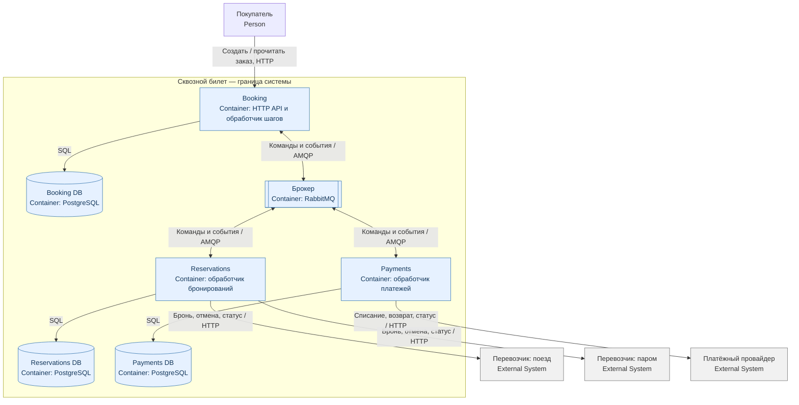

# 2. C4 Container

Синие блоки — наши приложения и хранилища, серые — внешние системы. HTTP API Booking — точка входа клиента. Брокер передаёт команды и результаты между сервисами.

Уровень C4 Container показан средствами Mermaid flowchart: граница системы, приложения, базы, брокер, внешние системы и протоколы связей.

## Простой стенд для реализации

Один PostgreSQL с тремя отдельными базами и пользователями, один RabbitMQ, три приложения. Внешние системы — три отдельных HTTP-симулятора со своими хранилищами, например файлами SQLite. Наша общая PostgreSQL-транзакция не может менять эти внешние данные.

У каждого сервиса один фоновый обработчик. Шаги выполняются последовательно, что упрощает восстановление. Состояние хранится в базе, а не в памяти процесса. Авторизация пользователей и доступ через интернет в учебный стенд не входят: он работает локально с одним тестовым пользователем.

## Сообщения

| Канал RabbitMQ | Отправитель → получатель |
|---|---|
| `reservations.commands.v1` | Booking → Reservations |
| `reservations.events.v1` | Reservations → Booking |
| `payments.commands.v1` | Booking → Payments |
| `payments.events.v1` | Payments → Booking |

В учебной версии каждому каналу соответствует одна durable-очередь с таким же именем. Публикация идёт через default exchange RabbitMQ по имени очереди. Сообщения persistent; отправитель ждёт подтверждение брокера, получатель подтверждает обработку после commit своей БД.

**Outbox:** сервис сохраняет изменение и сообщение одной транзакцией. Фоновый обработчик отправляет сообщение и помечает его отправленным. При падении между отправкой и отметкой сообщение придёт повторно.

**Inbox:** получатель запоминает ID сообщения вместе с изменением своих данных. Повторно доставленное сообщение не выполняет действие ещё раз. Внешний вызов дополнительно защищён постоянным ID операции.

Для демонстрации достаточно логов с `bookingId` и `operationId`. Временную ошибку повторяют через 5 секунд. Некорректное сообщение сохраняют в таблице ошибок для разбора, без изменения заказа. Кластер, репликация и мониторинговая платформа не требуются.
