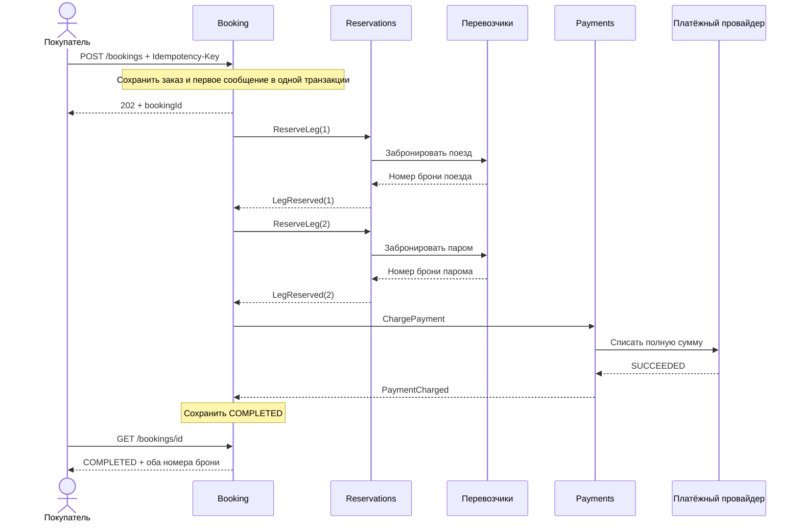
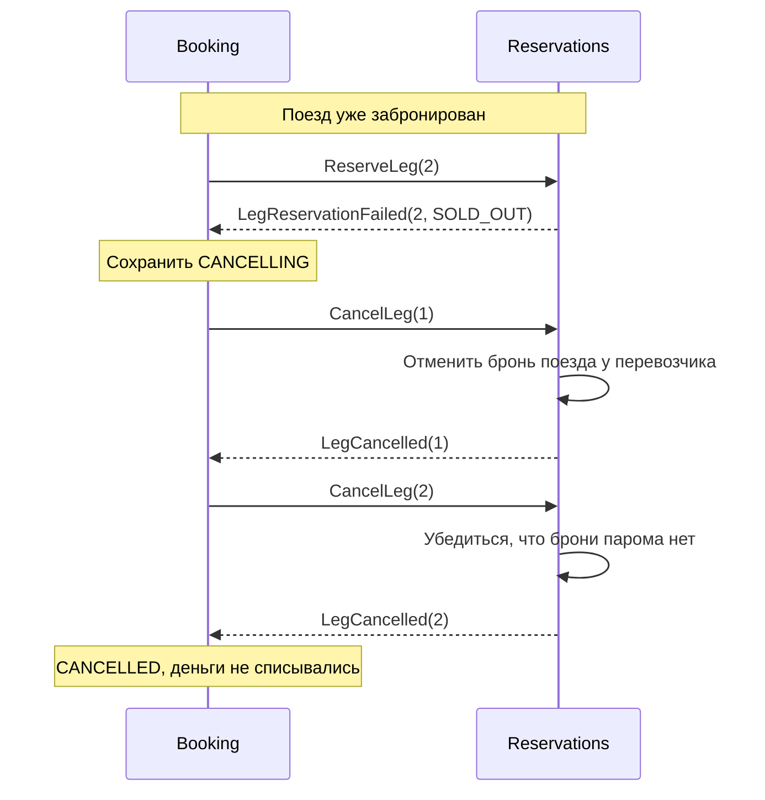
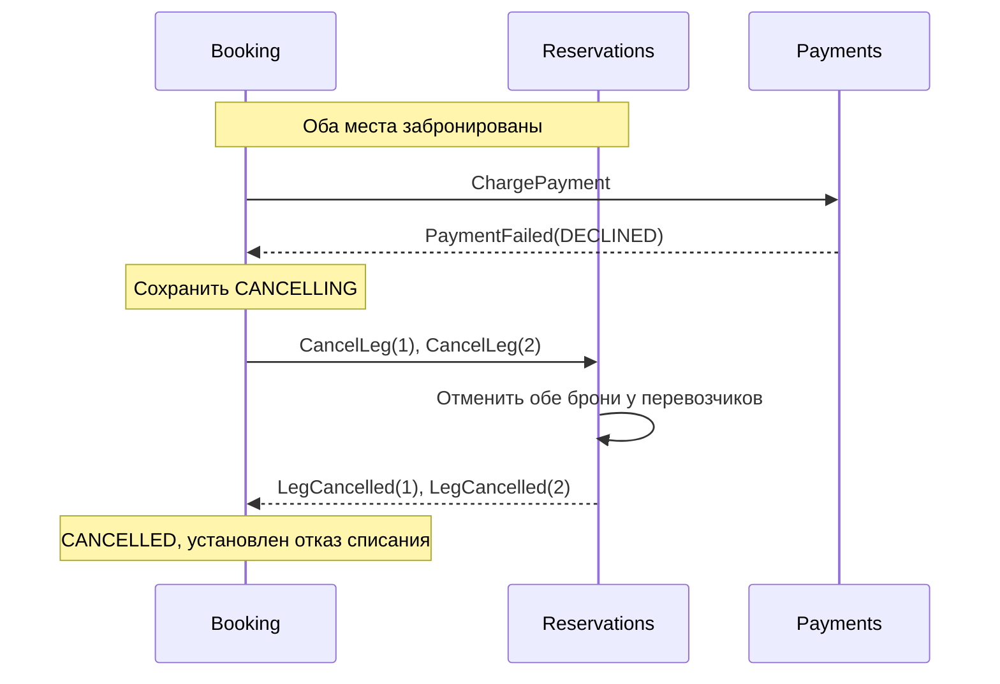
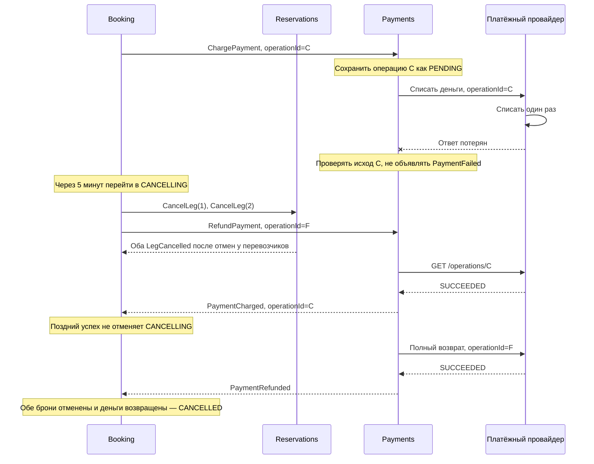

# 4. Главный процесс

**Забронировать поезд → забронировать паром → списать деньги → завершить заказ.** Booking запускает следующий шаг только после успеха предыдущего. Все команды и события на диаграммах идут через RabbitMQ; брокер скрыт, чтобы схема легче читалась.

## 1. Всё получилось

Перевозчики в этой схеме объединены в одного участника для компактности. В C4 это две независимые системы. Payments вызывается только после двух успешных броней. При успехе клиент получает обе брони вместе.

## 2. Сбой: на пароме нет места

Поезд уже забронирован, второй перевозчик отвечает SOLD_OUT. Booking отменяет обе части заказа; для несуществующей брони отмена просто подтверждает её отсутствие.

Компенсация — освобождение уже занятого места. Платёжная команда ещё не создавалась, поэтому возврат не нужен.

## 3. Сбой: платёж отклонён

Оба места забронированы, но платёжный провайдер окончательно отказал в списании.

Компенсация — отмена двух броней. Возврата нет, потому что достоверно известно: деньги не списаны. Если отмена брони временно не работает, заказ остаётся CANCELLING, а операция повторяется с тем же ID.

## 4. Сбой: деньги списаны, ответ потерялся

Самый важный случай: платёж прошёл, но Payments этого ещё не знает. Показан вариант, когда ожидание затянулось и Booking начал отмену.

Если исход выяснился до начала отмены, Booking просто завершает покупку. Если PSP всё ещё недоступен, возврат не объявляется успешным. При потере ответа на сам возврат проверяется ID возврата F — повторный возврат с новым ID не создаётся.

## Правила, общие для четырёх сценариев

| Правило | Для чего нужно |
|---|---|
| Текущий шаг и команды сохраняются в БД | После перезапуска продолжить с прежнего места. |
| HTTP-запрос партнёру ждёт до 5 секунд, затем сверка/повтор через 5 секунд | Не зависнуть на одном соединении и не принять тайм-аут за отказ. |
| Если за 5 минут покупка не закончилась, начать отмену | Ограничить время оформления; очистка ресурсов может занять дольше. |
| COMPLETED и начало отмены меняют одну строку заказа под блокировкой | При гонке последнего успеха и таймера выбрать только один исход. |
| После CANCELLING нельзя вернуться к покупке | Позднее событие успеха требует очистки, а не новых шагов. |
| CANCELLED требует двух LegCancelled и известного нулевого результата оплаты | Не скрыть оставшееся место или невозвращённые деньги. |

Если платёжная команда не создавалась или пришёл окончательный PaymentFailed, нулевой результат уже известен. Если она была отправлена, но исход неизвестен или успешен, требуется RefundPayment и событие PaymentRefunded. При отмене до старта брони Reservations запоминает отмену и запрещает позднее резервирование. Для уже отправленной брони сначала выясняет исход, затем освобождает место.

## Что показать на защите второй части

1. Успешная покупка: две брони и одно списание.
2. Отказ второго перевозчика: первая бронь освобождена.
3. Отказ оплаты: обе брони освобождены.
4. Списание с потерянным ответом: повторного списания нет, результат восстанавливается.
5. Повтор того же POST и перезапуск сервиса: заказ не задваивается и продолжает обработку.

Это план демонстрации. Реализации и выполненных тестов приложения в первой части нет.
